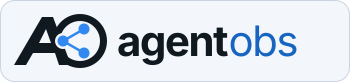
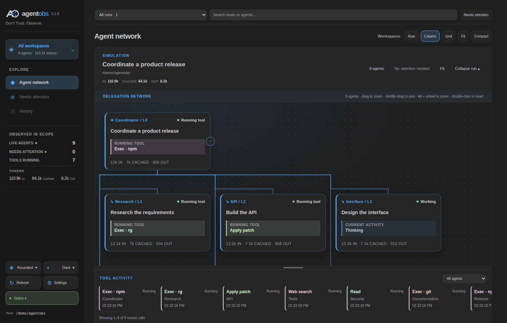
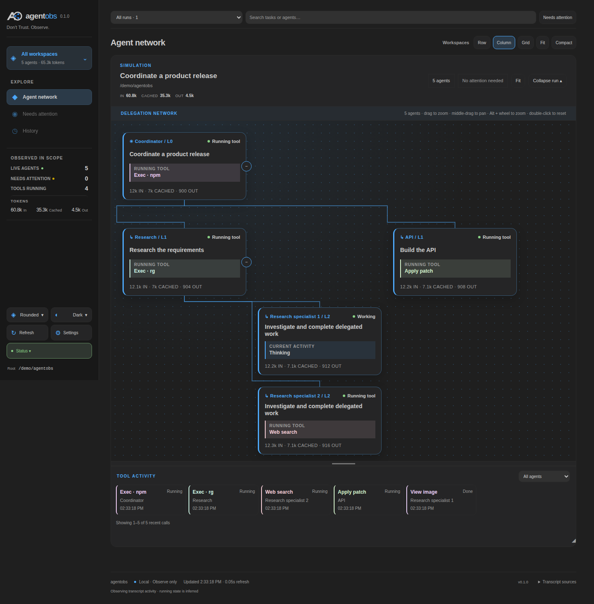
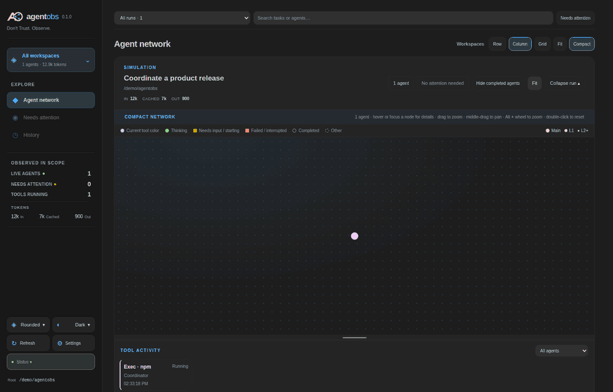
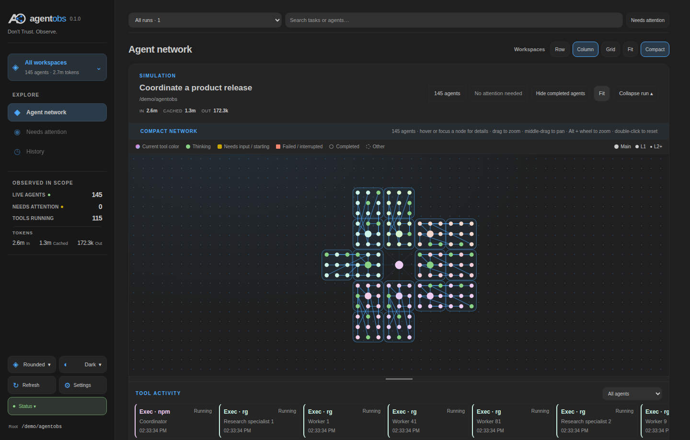
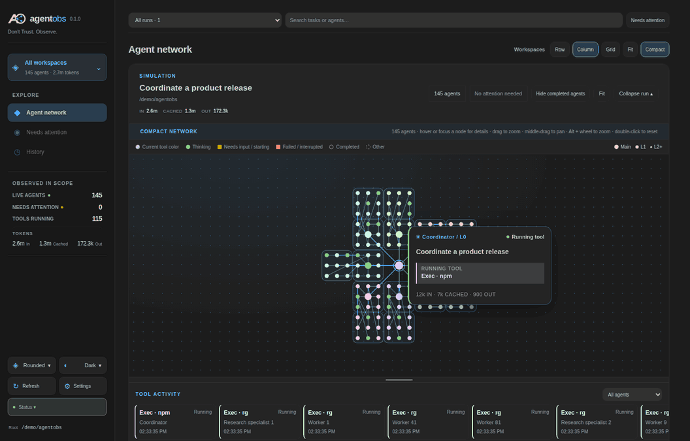
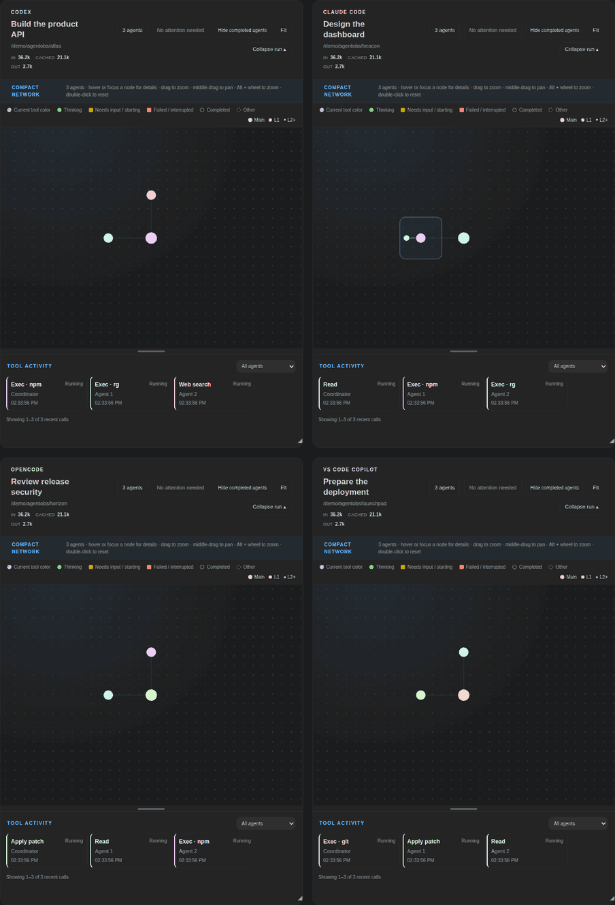

<div align="center">
  <h1><br><sub>Don't Trust. Observe.</sub></h1>
</div>

<p align="center"><a href="#showcase">Showcase</a> (<a href="#delegation">Delegation</a> · <a href="#follow-the-swarm">Follow the swarm</a> · <a href="#multiple-projects">Multiple projects</a>) · <a href="#what-you-can-see">Features</a> · <a href="#get-started">Get started</a> · <a href="#harnesses-and-discovery">Harnesses</a> · <a href="#local-by-design">Privacy</a> · <a href="#try-a-simulation">Simulation</a> · <a href="#development">Development</a> · <a href="#license">License</a></p>

---

A local dashboard for seeing what your coding agents are doing—together.

agentobs brings coding sessions from **Codex, VS Code Copilot, Claude Code, and OpenCode** into one workspace. Follow delegation, inspect running tools, track tokens, and find agents that need attention without switching between terminals.

<a href="docs/assets/agent-network.png?raw=1"></a>

> The screenshots and animations on this page use **synthetic simulation data**. No agent commands are executed by the simulation.

Click an image or animation to view it at full size.

## Showcase

### Delegation

The card view shows the coordinator, its delegated agents, and their nested
subagents as a connected hierarchy. Each card keeps its current task, activity,
and token usage in view; the tool activity strip shows recent work across the run.

<a href="docs/assets/delegation-cards.png?raw=1"></a>

### Follow the swarm

Compact mode turns an agent network into a living graph. Nodes are colored by tool activity; connections and clusters show who delegated to whom. Hover or focus a node to see its details, or open it for its full history.

<a href="docs/assets/compact-swarm.gif?raw=1"></a>

<details>
<summary>View the Compact network as a still image</summary>

<a href="docs/assets/compact-network.png?raw=1"></a>

</details>

<a href="docs/assets/compact-details.gif?raw=1"></a>

Switch back to cards when you need more context. Arrange workspaces in a **row, column, or grid**, resize them, filter completed nodes per workspace, and use Fit to find your way back. Drag a box to zoom, hold **Alt** and scroll to zoom around the pointer, or middle-drag to pan.

### Multiple projects

Follow four projects at once in a grid. This synthetic example shows Codex, Claude Code, OpenCode, and VS Code Copilot workspaces with different delegation patterns and tool activity.

<a href="docs/assets/multi-project-grid.gif?raw=1"></a>

## What you can see

- **Agent hierarchy:** coordinators, subagents, and nested delegation in a graph.
- **Current activity:** tool calls, working and attention states, and recent tool history.
- **Token usage:** input, cached input, and output, per agent and workspace when recorded.
- **Workspaces and history:** search runs, focus on one workspace, and revisit completed or inactive work.
- **Appearance:** six visual themes and eight independent color palettes.
- **Monitoring health:** source availability, ingestion limits, and stale observations in the status panel.

Activity is inferred from recorded harness data. An open terminal alone does not prove an agent is currently working, and missing data stays unknown.

## Get started

**Requirements:** Node.js 22+, npm, and a supported coding harness with local session data.

> The npm release is being prepared. The examples below assume the planned package name `agentobs`; they will work after that package is published. Until then, use the source instructions under [Development](#development).

From a project directory, start agentobs with:

```bash
npx agentobs
```

Open **[http://127.0.0.1:4317](http://127.0.0.1:4317)**. agentobs monitors the current directory and its subdirectories. To see several projects at once, run it from their parent directory or specify a root:

```bash
npx agentobs --root /path/to/your/projects
```

The CLI prints the dashboard address and discovered store paths. Leave it running while you observe your agents; press `Ctrl+C` to stop it. If the port is in use, start with `npx agentobs --port 4318`.

No setup file is required. You can optionally save configuration for a directory:

```bash
npx agentobs init /path/to/your/projects
```

This creates `.agentobs/dashboard.json` without overwriting an existing file. Start again with `npx agentobs --root /path/to/your/projects`. Run `npx agentobs --help` for the available options.

## Harnesses and discovery

agentobs discovers local stores automatically and displays sessions whose **recorded workspace is inside the monitored root**. A store can live outside that root.

| Harness | Default source | Support |
| --- | --- | --- |
| Codex | `$CODEX_HOME/sessions` or `~/.codex/sessions`, plus `<root>/.codex/sessions` | Rollout JSONL; known 0.160, 0.162, 0.164, and 0.166 families, with best-effort handling for recognizable newer records. |
| VS Code Copilot Chat | VS Code Stable and Insiders `User/workspaceStorage` | Local chat sessions, transcripts, and debug logs; best effort. Copilot CLI is not currently supported. |
| Claude Code | `$CLAUDE_CONFIG_DIR/projects` or `~/.claude/projects` | Local session and subagent JSONL; best effort. Some permission and deeper delegation states may be unavailable. |
| OpenCode | `$OPENCODE_DB` or `$XDG_DATA_HOME/opencode/opencode.db` | Read-only legacy and v2 SQLite; best effort. Older JSON stores are not supported. |

Open **Settings** in the sidebar to inspect resolved paths, add custom paths, or disable a harness. Saved changes take effect after restarting; command-line options take precedence.

You can also provide custom stores directly. Each option may be repeated:

```bash
npx agentobs --root /path/to/projects \
  --sessions /path/to/codex/sessions \
  --opencode-storage /path/to/opencode.db
```

The other store options are `--copilot-storage` and `--claude-storage`. A supplied option replaces that harness's default paths. Missing or unreadable stores appear in **Status** without preventing startup.

For more detailed Copilot token and subagent data, enable VS Code's `github.copilot.chat.agentDebugLog.fileLogging.enabled` setting. Debug logs are buffered, so updates may appear later than the activity itself.

If a session is missing, check that its workspace is under the monitored root, then check its store path and any read errors in **Settings** and **Status**.

## Local by design

The dashboard listens on loopback and rejects foreign hosts and cross-origin browser requests. It observes local records; it does not control agents or upload their data. Settings can update the local configuration file; transcript stores remain read-only.

The dashboard displays task text, progress, and workspace paths. Its local `.agentobs/` index contains reduced summaries, including task text and paths; raw transcripts and tool arguments or outputs are not copied into that index. Keep `.agentobs/` out of version control and treat screenshots as potentially sensitive when they show real work.

## Try a simulation

The simulation is available from a source checkout and creates isolated, clearly labeled sample sessions:

```bash
npm ci
npm run browser:install
npm run demo:agents
```

It opens a browser using a temporary simulation store. The Compact animations above were captured from isolated synthetic sessions. To regenerate the README media from a checkout, install Playwright's browser and Python Pillow, then run `node scripts/capture-readme.js` and `node scripts/capture-multi-project.js`.

For a Copilot-shaped fixture, `npm run demo:copilot` writes labeled demo data under the current root's ignored `.agentobs/copilot/` directory. Re-running it resets that demo data.

## Development

Clone the repository and run from its directory:

```bash
npm ci
npm start -- --root /path/to/your/projects
```

To run the checks:

```bash
npm test
npm run browser:install
npm run test:modern
npm run test:settings
npm run test:new-harnesses
npm run test:package
```

Browser tests use Playwright Chromium; set `CHROME_BIN` to use a different executable. They need local loopback access. See [architecture](ARCHITECTURE.md) for implementation details.

## License

[MIT](LICENSE). agentobs builds on [Codex Session Observer](https://github.com/schelmi1/codex-session-observer).
